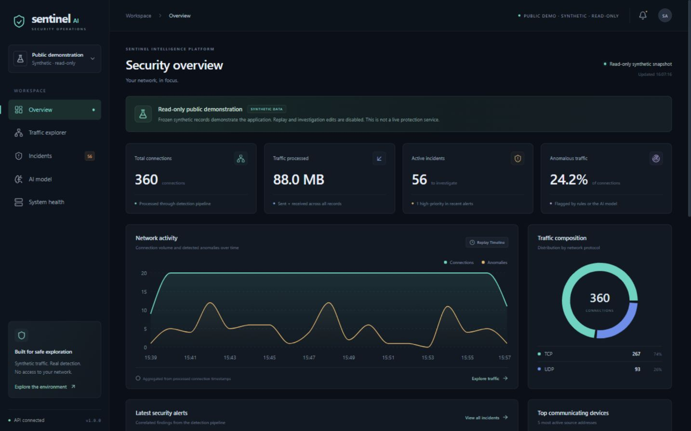
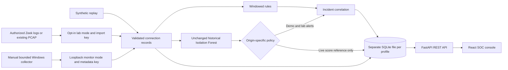

# Sentinel AI

Network telemetry analysis, explainable threat indicators, and incident investigation in a Python/FastAPI application with a React SOC console.

**Sentinel AI is an educational and research-oriented security monitoring project, not a validated production intrusion prevention system.**

**The default application is a synthetic demonstration.** It replays synthetic connection records without scanning hosts, capturing packets, contacting the displayed addresses, or accessing a private network. Optional workflows import authorized lab files or run explicitly opted-in disposable localhost experiments. **No live-network protection or production detection performance has been demonstrated.**

A separate, off-by-default [Windows Ethernet metadata profile](docs/windows-monitoring.md) is implemented for explicitly authorized, bounded local collection. An initial process-context restriction was later resolved in normal Windows execution: 164 genuine packets produced 18 stored Live Ethernet flow records and two historical benchmark ML incidents, with the display verified by the owner. This does not establish continuous monitoring or proven protection. The existing demo does not enable or start collection.



[Run locally](#run-locally) · [Features](#features) · [Model results](#model-results) · [Architecture](#architecture) · [Authorized lab](#authorized-ubuntu-lab-ingestion) · [Windows metadata profile](#optional-windows-ethernet-metadata-profile) · [Verification](docs/verification.md)

## Features

| Area | Implemented behavior |
|---|---|
| Safe replay | Start, pause, resume, change replay speed, and reset a 360-record synthetic scenario. The first launch seeds 120 records. |
| Network analytics | Connection and byte totals, flagged-connection rate, timestamped activity charts, protocol composition, and top source addresses. |
| Traffic explorer | Source/destination IPs and ports, protocol, duration, directional bytes, connection state, record origin, and an uncalibrated model outlier score when one exists. Search, protocol filtering, pagination, full timestamp hints, and CSV export with available collection/flow lineage and byte semantics. |
| Detection rules | Windowed port-scan indicators, unusual connection frequency, repeated failed states when available, protocol/port mismatches, and large outbound transfers. |
| Anomaly detection | The preserved Isolation Forest scores per-connection features. Demo/Lab model alerts remain distinguished from rule alerts. Live Ethernet baseline scores are informational only and do not create new ML incidents. |
| Incident workflow | Correlation, severity/source/status filters, investigation notes, status changes, and history persisted in SQLite. |
| Model visibility | Actual held-out metrics, confusion matrix, feature definitions, provenance, and limitations. |
| Optional lab imports | Keyed, passive import of Zeek JSON/TSV logs. Existing-PCAP conversion requires an explicitly enabled adapter and local tshark. |
| Controlled localhost experiments | An explicit runner measures actual exchanges with its own disposable loopback services and evaluates the unchanged live rules in a new lab database. Endpoint instrumentation is labeled separately from file imports and Ethernet capture. |
| Optional Windows metadata profile | Separate loopback API/database and an explicitly opted-in, one-window dumpcap→TShark CLI. Live Ethernet origin, bounded flow observations, and read-only compatibility/context are distinguished from synthetic/file-import data. A bounded real collection was verified; real-traffic detection quality remains unverified. |

CSV export includes record origin, available evidence lineage and score qualifications, and neutralizes spreadsheet-formula prefixes in untrusted text. It exports the current loaded page; changing filters disables export until matching results arrive. Reset removes synthetic records and their incidents while retaining imported lab evidence. Visitors to a normal local backend share its replay, incidents and notes; the separate public profile is a frozen, read-only synthetic snapshot.

## Run locally

Requirements:

- Python **3.11 or 3.12**, with venv support.
- Node.js **22.12 or later** and npm. The supplied Vite 8 toolchain requires a compatible modern Node runtime; the recorded build used Node 22.19.
- Git or an extracted source copy, and internet access for dependency installation. The included model runs locally; startup does not download training data.

Open two terminals at the repository root. Commands below call the virtual environment's Python explicitly, so activation and PowerShell execution-policy changes are unnecessary.

### Terminal 1: backend

**Windows PowerShell** — choose the supported Python version installed on your machine (`py -3.12` can replace `py -3.11`):

```powershell
py -3.11 -m venv .venv
.\.venv\Scripts\python.exe -m pip install --upgrade pip setuptools
.\.venv\Scripts\python.exe -m pip install -r requirements.txt
.\.venv\Scripts\python.exe -m uvicorn backend.app.main:app --host 127.0.0.1 --port 8000
```

**Ubuntu 24.04** — its default Python 3.12 is supported:

```sh
sudo apt-get update
sudo apt-get install -y python3 python3-venv
python3 -m venv .venv
.venv/bin/python -m pip install --upgrade pip setuptools
.venv/bin/python -m pip install -r requirements.txt
.venv/bin/python -m uvicorn backend.app.main:app --host 127.0.0.1 --port 8000
```

For another Linux distribution or macOS, install Python 3.11/3.12 and use the same venv commands with that interpreter. The recorded application validation was on Windows; Linux/macOS startup is not claimed as an executed check.

Use **one backend process/worker**. SQLite state is created automatically under `data/`. Keep the backend terminal open.

### Terminal 2: frontend

```sh
cd frontend
npm ci
npm run dev
```

Open the [SOC console](http://127.0.0.1:5173). The development server proxies `/api` to the backend. [Interactive API documentation](http://127.0.0.1:8000/docs) is available on the backend port.

To explore: start the simulation, watch connections and detections appear, open an incident, save a note or change its status, then review the Traffic explorer and AI model views. Reset prepares a fresh replay.

### Docker Compose alternative

With Docker Engine/Desktop and the Compose plugin running:

```sh
docker compose up --build -d
docker compose ps
```

Open the [containerized console](http://127.0.0.1:8080). The supplied configuration forces synthetic demo mode, disables PCAP imports, and binds only the frontend to a loopback host port. State persists in the named `sentinel-data` volume. Stop with `docker compose down`; adding `-v` deletes that saved state.

Compose configuration was validated, but image build and container startup were not executed during the recorded verification. See [deployment documentation](docs/deployment.md).

### Separate read-only public demonstration

The optional `SENTINEL_PUBLIC_DEMO=true` profile uses its own explicitly selected database, seeds the complete 360-record synthetic scenario, and reports `public_demo` plus mutation capabilities to the UI. Replay/reset controls are hidden; incident status and notes are read-only. The API rejects all mutation requests, including imports, with HTTP 403. Ordinary local Demo Mode retains its interactive replay and investigation workflow.

The public profile refuses existing private, unmarked or other-profile databases rather than sanitizing or reusing them. It cannot enable monitor mode, lab imports or PCAP processing. The supplied isolated Compose file uses a separate named volume and exposes only its frontend on loopback:

```sh
docker compose -f docker-compose.public-demo.yml up --build -d
docker compose -f docker-compose.public-demo.yml ps
```

Its local preview is [127.0.0.1:8082](http://127.0.0.1:8082). These commands prepare a local preview, not a public deployment. Never mount a home-network database, notes, captures, secrets or private exports into this profile. Container execution and hosting readiness must be assessed from [the dated verification](docs/verification.md) and [deployment guide](docs/deployment.md); no published URL is claimed here.

## Architecture



The frontend polls the API; detections run when records are ingested. Training is an independent, reproducible pipeline. See [the architecture and boundaries](docs/architecture.md) for persistence, deployment, and data flow.

Interactive demo, authorized lab, local monitor and the read-only public snapshot use separate database roles. Controlled experiments additionally require a new exclusive lab-run database. The monitor API never starts capture; only an explicitly authorized local launcher/CLI opens a selected interface. A public demo must never use a private lab/monitor database.

**Stack:** Python, FastAPI, SQLite, scikit-learn, pandas, NumPy, React, TypeScript, Vite, Tailwind CSS, Recharts, Docker Compose, and pytest.

```text
backend/app/       REST API, SQLite storage, replay, rules, and passive parsers
detection/         Shared feature preparation and model inference
frontend/          React/TypeScript SOC console
data/examples/     Sanitized Zeek fixtures using documentation addresses
models/           Included model, measured evaluation report, and model card
scripts/          Training, authorized imports, monitoring and controlled lab CLIs
tests/            Backend, detection, ingestion, persistence, and ML checks
docs/             Architecture, lab/deployment guides, screenshots, verification
```

## Model results

The included model uses the **KDD Cup 1999 10%** public research benchmark. That dataset contains historical laboratory-generated traffic with published labels; it is separate from the application's synthetic replay.

Exact raw duplicates are removed, and rows with identical canonical inference features remain in the same train/validation/test group. The 60/20/20 targets apply to distinct feature groups, so row counts differ. Only **53,953 benign training rows** fit preprocessing and the Isolation Forest. **16,790 benign validation rows** fix the threshold before evaluation. The held-out test contains **19,887 rows**: 17,089 benign and 2,798 labeled attacks.

Results from the included [evaluation artifact](models/metrics.json):

| Metric | Measured value |
|---|---:|
| Precision | 51.04% |
| Recall | 20.12% |
| F1 score | 28.86% |
| Benign false-positive rate | 3.16% |
| ROC AUC | 85.40% |

| Actual / predicted | Benign | Attack |
|---|---:|---:|
| Benign | 16,549 | 540 |
| Attack | 2,235 | 563 |

**The baseline missed 2,235 of the 2,798 test attacks.** These measured results support an educational demonstration of evaluation and investigation; they do not establish effective protection on a modern network. Rare benign services account for many false positives. An outlier score is not an attack probability, and the supplied indicators are heuristic explanations rather than causal attribution. No temporal or host-separated deployment validation was possible with the available benchmark fields.

See the [model card](models/model_card.md) for feature mappings, leakage controls, false-positive analysis, hashes, and additional limitations. The original model artifact, evaluation JSON and model card are preserved unchanged. The [live-detection policy](docs/live-detection.md) explains why the historical score/threshold is only an informational reference for actual interface metadata; no model was retrained or threshold retuned.

### Reproduce training

From the repository root, use the same pinned dependencies. Downloading is needed only for retraining.

**Windows PowerShell:**

```powershell
.\.venv\Scripts\python.exe scripts/train_model.py --download --output models
# Or use a previously downloaded archive:
.\.venv\Scripts\python.exe scripts/train_model.py --data data/raw/kddcup.data_10_percent.gz --output models
```

**Linux/macOS:**

```sh
.venv/bin/python scripts/train_model.py --download --output models
# Or use a previously downloaded archive:
.venv/bin/python scripts/train_model.py --data data/raw/kddcup.data_10_percent.gz --output models
```

Raw data remains in ignored `data/raw/`. Review generated model artifacts before replacing the included files, then restart the backend. Only load trusted joblib/pickle files: deserialization can execute code. Missing, incompatible, or mismatched artifacts produce an explicit rule-only fallback.

Dataset attribution: Stolfo, Fan, Lee, Prodromidis, and Chan (1999), [UCI KDD Cup 1999 Data](https://doi.org/10.24432/C51C7N), CC BY 4.0. The model metadata records the checksum-verified download mirror and dataset/model-artifact hashes.

## Authorized Ubuntu lab ingestion

Lab mode reads **existing files**. It does not capture interfaces, tail a live sensor, scan hosts, block traffic, or modify firewalls. Zeek and tshark are unnecessary for the default demo or for importing an existing Zeek log.

Follow the [Ubuntu lab guide](docs/lab-setup.md) for Zeek installation and optional offline PCAP processing. On Ubuntu, a backend terminal can enable imports as follows:

```sh
export SENTINEL_LAB_MODE=true
export SENTINEL_DB_PATH=data/lab.db
export SENTINEL_API_KEY="$(.venv/bin/python -c 'import secrets; print(secrets.token_urlsafe(32))')"
# Enable only when importing existing PCAP files and tshark is installed:
# export SENTINEL_PCAP_ENABLED=true
.venv/bin/python -m uvicorn backend.app.main:app --host 127.0.0.1 --port 8000
```

Set the **same secret** in the import terminal, then use the sanitized fixtures or an authorized local file:

```sh
.venv/bin/python scripts/import_lab.py data/examples/conn.json --format json
.venv/bin/python scripts/import_lab.py data/examples/conn.log --format tsv
# Optional existing-PCAP adapter:
.venv/bin/python scripts/import_lab.py /path/to/authorized-lab.pcap --format pcap
```

The System view also accepts a Zeek log and the import key; the key remains in page memory. Imported records are labeled by origin. Use separate SQLite files for lab and public-demo data: demo startup rejects a database containing lab records.

PCAP processing is a limited adapter: TCP/UDP only, at most 20 MB/50,000 packets, coarse bidirectional five-tuple aggregation, inferred states, and frame-byte totals. Reused tuples can merge separate sessions. It is not equivalent to Zeek session telemetry. End-to-end Zeek/offline-PCAP conversion was not verified by the original baseline; the separate Windows collector's later bounded verification is described below.

Backend configuration variables are listed in [.env.example](.env.example). The backend reads its process environment; copying that file to `.env` alone does not configure the backend commands above. To load such a file explicitly, add `--env-file .env` to the uvicorn command. Never commit an actual secret or private telemetry.

The frontend's `frontend/.env.example` documents `VITE_API_BASE`: leave it empty for the development/Compose proxy, or set a public backend origin when preparing a separate frontend build. Vite exposes `VITE_` values in browser JavaScript. Never place an API key or other secret in a frontend environment variable. See [separate-service hosting](docs/deployment.md#separate-services) for CORS and persistent storage requirements.

## Optional Windows Ethernet metadata profile

Follow the [Windows monitoring guide](docs/windows-monitoring.md) for read-only capability queries, dry-run review, isolated startup, and a separately authorized one-time collector. Monitor mode is **off by default** (`SENTINEL_MONITOR_MODE=false`); it is mutually exclusive with lab mode and requires a new/dedicated database. The examples use backend `127.0.0.1:8004` and frontend `127.0.0.1:5176`, separate from demo and existing lab services.

After installing the documented dependencies and trusted Windows capture prerequisites, the local menu reduces repeated setup:

```powershell
# Prerequisite/inventory check only; no services, key prompt or capture:
.\.venv\Scripts\python.exe scripts/local_monitor.py --check
# Explicit local menu:
.\sentinel-monitor.cmd
```

The menu can select one wired adapter, start/reuse fixed local services, show metadata-receipt status, open the dashboard, and stop only services it owns. One capture requires a separate `START` confirmation and runs for at most 15 seconds/5,000 packets/1,000 flow aggregates. A new owned backend uses the dedicated `data/monitoring/windows-monitor.db` and an ephemeral key; an existing external monitor keeps its own database/key and requires a private existing-key prompt only if capture is requested. Saved adapter preference never authorizes automatic collection. Use the [launcher guide](docs/windows-monitoring.md#local-launcher) before starting services, especially when preserving an existing monitor configuration.

The CLI selects an exact Ethernet interface and assigned local addresses, defaults to 20 seconds, and is bounded to at most 120 seconds, 5,000 packets, and 1,000 in-memory flow aggregates. No `--enable-capture` means no interface access; `--ingest` is a separate opt-in. Keys are read from a process environment or `--ask-key`, never a command-line key argument. The API and browser have no capture-start operation, and monitor mode hides/rejects replay actions.

dumpcap stdout is piped directly into TShark stdin with no raw packet filename requested. **The 128-byte prefixes can contain application fragments in RAM.** Only allowlisted connection metadata is exported. Sent/received values are header-derived transport payload lengths, including retransmissions, not wire bytes or verified payload contents. Records are bounded-window observations with lower-bound durations, local-host orientation, unknown services, and no process or authentication-result attribution. Those differences introduce model domain shift; the historical metrics above do not validate laptop traffic.

Metadata reaches the backend after a collection window stops. `receiving` means recent API ingest, not that capture is running. A 5,000-row default capacity cap stops new ingestion without automatically deleting evidence. Private databases, optional metadata exports, real local GUIDs/addresses, keys, and screenshots stay out of public source/docs. The guide does not install drivers, change ACLs/router settings, weaken security controls, or automatically elevate.

The original blocked hardware check and synthetic decoder tests remain dated in [verification](docs/verification.md). A later owner-verified normal Windows collection processed 164 genuine packets, stored 18 live flow records and two historical ML incidents, and displayed those records. The 1 November detection-intelligence upgrade was subsequently activated and visually reviewed by the owner. No new capture is needed to inspect those preserved records. These checks do not establish operational detection accuracy.

## Controlled localhost verification

The runner first prints a plan without opening services or creating evidence. Execution requires a separate explicit flag:

```powershell
.\.venv\Scripts\python.exe scripts/verify_controlled_lab.py
# Only when authorizing a new bounded disposable localhost experiment:
.\.venv\Scripts\python.exe scripts/verify_controlled_lab.py --execute
```

It binds only retained `127.0.0.1` services and accepts no remote destination. Scenarios cover eight owned TCP ports, a 25-exchange TCP burst, a verified large upload, small TLS-verified HTTPS requests, DNS exchanges, SSDP-format unicast exchanges, and a router-role HTTP simulator. The last two are controlled application scenarios, not actual multicast or communication with a household router.

Each run creates a new evidence directory and `controlled-lab.db` under ignored `data/lab-runs/`; existing directories/databases are refused. Records have `origin=lab` and `collector=localhost-lab`. Counts measure application bytes at owned endpoints, not captured transport lengths; no packet counters or TShark/Zeek provenance are invented. The preserved Isolation Forest is not loaded or scored, and its thresholds are unchanged. See [verification](docs/verification.md) for executed outcomes, severity, misses and false-positive concerns; implementation alone is not evidence that a scenario passed.

## Live detection intelligence

Live Ethernet now separates **observed rule conditions** from the unvalidated KDD99 reference score. Demo/Lab detections, the existing Isolation Forest artifact and threshold, and saved incident priorities/status/notes/history remain unchanged. New live records retain the baseline score and a compatibility assessment; above-threshold baseline scores no longer create new live ML incidents. Existing historical ML incidents stay visible.

The live review rules use unique flow identifiers within one source/peer/collection:

- At least eight distinct ports on one peer within 60 seconds, with observed local TCP initiation: high-priority port-scan indicators.
- At least 25 unique locally initiated TCP flow observations to one peer within 60 seconds: medium-priority burst review. A port sweep that already explains the burst suppresses that redundant burst finding.
- At least 5,000,000 header-derived outbound bytes from wholly contained observations within 60 seconds, or one bounded observation reaching that amount over its own longer span: medium-priority volume review. The longer observation is not a 60-second rate claim; neither finding establishes data exfiltration.

Port-based SSDP, DNS, DHCP, mDNS, HTTPS/QUIC and other context is descriptive. A private peer is not automatically identified as a router. These hints do not whitelist destinations or prove benign activity. Login failures require genuine authentication events, not TCP observations. Partial collection, responder/unknown roles, retransmissions and unknown application service limit both rules and model comparison.

Incident details distinguish the saved score from its threshold provenance, heuristic model indicators from rule triggers, saved triage priority from attack confidence, and missing evidence from observed facts. Old records receive a **read-only derived assessment without rescoring or changing stored history**. Where no original threshold was stored, the displayed threshold is explicitly a current preserved-baseline reference, not an invented historical value. Comparison uses the reported six-decimal score; rounding can affect a boundary comparison, and the original full-precision decision is not recovered.

See [live detection and evaluation](docs/live-detection.md) for limitations, the original anomaly investigation and the 27 constructed regression scenarios. Those scenario labels are author-assigned test intent, not real-network ground truth; fewer benchmark-generated alerts does not establish higher operational accuracy. Slow/cross-window activity, UDP or midstream scans, low-volume malicious behavior and authentication failures can still be missed.

To load this update, [restart the existing private monitor service](docs/windows-monitoring.md#update-and-view-existing-stored-observations) using its current environment/key and the **same dedicated database**. No new key, retraining or capture is needed to view the already stored flows.

## Verification and deployment boundaries

The [dated verification report](docs/verification.md) separates the original 29 October checks, the completed 1 November detection-intelligence baseline, and the 7 November release work. The final Windows run passed **328 Python tests**, **18 frontend tests**, and the standard production build. Genuine localhost experiments and actual desktop/mobile browser checks are documented in [testing](docs/testing.md). See [the v1 release report](docs/release-v1.md) and [known issues](docs/known-issues.md) for scope and remaining checks. The [GitHub Actions workflow](.github/workflows/check.yml) is included; a future CI run should establish its result rather than an unverified status badge.

Earlier test totals and restrictions remain dated history in that report. The completed 1 November baseline had 165 Python and eight frontend tests, a production build, and an owner-reviewed activated detection-policy UI. The 7 November 2026 release checks are reported separately rather than treating an older hardware restriction as a current blocker. Public screenshots exclude private home-network telemetry.

Run the available checks from the repository root:

**Windows PowerShell:**

```powershell
.\.venv\Scripts\python.exe -m pytest -q
cd frontend
node --experimental-strip-types --test tests/presentation.test.mjs tests/request.test.mjs tests/csv.test.mjs
npm run typecheck
npm run build
```

**Linux/macOS:**

```sh
.venv/bin/python -m pytest -q
cd frontend
node --experimental-strip-types --test tests/presentation.test.mjs tests/request.test.mjs tests/csv.test.mjs
npm run typecheck
npm run build
```

The 7 November 2026 v1 polish preserves the five views and investigation workflow. Unknown API state uses neutral provenance labels; filtered lists wait for matching results; incident load failures have Retry; request cancellation retains a 12-second deadline; and mobile navigation contains keyboard focus and closes with Escape. Source/unit checks and browser checks are reported separately in [verification](docs/verification.md).

This is a single-worker application with shared state. Private telemetry reads and local incident edits have no multi-user login; ingestion keys protect the keyed import paths. Private monitor/lab APIs require loopback clients and literal loopback Host headers, with trusted browser origins for writes. CORS is not authentication. Keep private services local. Only the isolated synthetic read-only profile is prepared for possible public hosting. See [hosting preparation](docs/deployment.md).

There is no published repository or public demo URL recorded for this project. The [portfolio content](docs/portfolio-showcase.md) is a draft for a separately approved update.

## Screenshots

The following genuine screenshots were captured from the rendered application on **7 November 2026**. Public-demo views contain only synthetic data; controlled-lab views contain only owned localhost activity. No private Ethernet screenshot is published.

- [Read-only synthetic overview](docs/screenshots/v1-public-overview.jpg)
- [Filtered synthetic traffic](docs/screenshots/v1-public-traffic.jpg)
- [Read-only public investigation](docs/screenshots/v1-public-investigation.jpg)
- [Controlled localhost overview: 49 records and three findings](docs/screenshots/v1-controlled-lab-overview.jpg)
- [Investigation notes and history on a controlled-lab copy](docs/screenshots/v1-controlled-lab.jpg)
- [Responsive mobile model page](docs/screenshots/v1-mobile-model.jpg)

The five original **29 October 2026** synthetic-demo screenshots remain unchanged as historical evidence:

- [Network overview](docs/screenshots/overview.jpg)
- [Traffic explorer](docs/screenshots/traffic-explorer.jpg)
- [Incident investigation](docs/screenshots/investigation.jpg)
- [Model evaluation](docs/screenshots/model-evaluation.jpg)
- [Mobile model view](docs/screenshots/mobile-model.jpg)

## License

Application source is provided under the [MIT License](LICENSE). Dataset and dependency licenses remain separate; the dataset credit above and in the model card identifies its source and CC BY 4.0 license. Included dependency/asset notices are recorded in [third-party notices](frontend/public/third-party-notices.txt).

## Publication review

The [publication audit](docs/publication-audit.md) records the current checks, file decisions, and remaining validation limits. Use the [reviewed file manifest](docs/publication-files.txt) together with [the security and data-handling guidance](SECURITY.md) when preparing a future commit. Local virtual environments, dependencies, SQLite state, private traffic files, raw downloads, and real environment secrets are not publication material.
