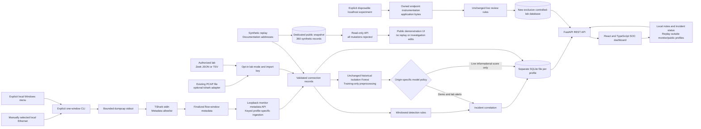

# Architecture

## Profiles and persistence

The frontend polls the API. Inference and rule evaluation happen at ingestion time; the controlled endpoint runner evaluates the live rules directly without loading the benchmark model. SQLite persists records, correlated incidents, investigation history, and replay/monitor metadata. Each backend uses one worker. Interactive demo, authorized lab, local Windows monitor and the read-only public snapshot have separate database roles; controlled experiments additionally require a new exclusive run database. The diagram shares processing components conceptually, not private database contents.

- **Demo:** synthetic replay; it never contacts the addresses in its records. Its default startup/Compose workflow does not enable monitoring.
- **Authorized lab:** imports already collected Zeek JSON/TSV or an existing PCAP through an opt-in keyed file API. The offline PCAP adapter is a separate coarse five-tuple/frame-byte path, not the Windows collector.
- **Controlled lab:** an explicit runner owns disposable loopback services, records measured endpoint exchanges and applies the unchanged live rules in a new `controlled_lab` database. `origin=lab`, `collector=localhost-lab`, application-byte semantics and scenario evidence distinguish it from Zeek/TShark. It does not run the Isolation Forest or exercise Ethernet decoding.
- **Local monitor:** off by default; requires an explicitly selected dedicated database and is mutually exclusive with lab mode. It has no synthetic seed/replay controls. Profile validation refuses incompatible existing demo/lab/unmarked databases and does not clear them. Demo/lab also refuse monitor-role/live-data reuse.
- **Public snapshot:** `SENTINEL_PUBLIC_DEMO=true` requires a new/dedicated synthetic-only database, seeds 360 records and disables every API mutation. Its API still reports `mode=demo` with `public_demo=true` and explicit capabilities. It cannot enable lab/monitor/PCAP profiles or reuse private/unmarked databases. Normal Demo Mode remains interactive.

Monitor ingestion is restricted to loopback and a matching import key. Batches contain at most 50 finalized flow observations; duplicate-batch handling prevents blind retries from inflating stored counts. The default 5,000-row cap stops new ingestion while preserving existing records/incidents; it is not automatic retention deletion or secure erasure.

Private lab and monitor requests require literal loopback Host headers and loopback clients. Browser writes additionally check the configured trusted Origin; neither this nor CORS is per-user authentication. Ingestion keys do not turn local telemetry reads/incident edits into a multi-user authorization system.

## Local launcher

`sentinel-monitor.cmd` starts `scripts/local_monitor.py --interactive`; the Python default/`--check` performs read-only prerequisite and wired-adapter inventory. The menu starts/reuses fixed loopback services, opens the fixed dashboard only on request, and calls the existing collector only after a current adapter selection and explicit `START` confirmation. One action is fixed to 15 seconds, 5,000 packets and 1,000 flow aggregates. The API remains unable to start capture.

Owned services are tracked by child-process handles, not discovered/killed by PID, name or port. The fixed monitor database is preserved; a reused external monitor keeps its own database/key. Newly owned backends receive an ephemeral key in memory/child environment; an external monitor's existing key is privately prompted only for capture and is never discovered or overwritten. Preferences store only the adapter identifier/label under private `data/monitoring/`; assigned addresses are refreshed twice around preflight. The launcher checks physical inventory or requires explicit wired-hardware confirmation, and refuses a disconnected/changed adapter without fallback.

Frontend child environment settings are allowlisted; actual frontend environment files with unexpected `VITE_` settings stop launcher startup. Exiting stops only owned services. There is no automatic elevation, installation, permission change, continuous capture or browser command execution. See [the launcher guide](windows-monitoring.md#local-launcher) for the fixed ports, preserved-database workflow and operational limits.

## Bounded Windows collector

Only the independently authorized CLI can open the exact selected interface. A dry run launches no executable, opens no interface, and sends no API request. An actual run is bounded by time, packet count, flow aggregates, and shutdown deadlines. It disables promiscuous capture/name resolution and filters supplied assigned local addresses plus TCP/UDP. The API/browser never starts a capture process and does not automatically elevate, install drivers, change permissions, scan hosts, or modify a router/firewall.

Dumpcap writes a binary stream to stdout and TShark reads stdin. No raw packet filename or temporary capture file is requested. The 128-byte prefixes can contain payload fragments in process/pipe memory; the decoder outputs only fixed connection-metadata fields. Optional metadata JSON remains under ignored `data/monitoring/`, and private capture/metadata evidence is not part of public artifacts.

The collector emits each finalized flow once per bounded window and submits metadata only after that window stops. API `receiving` reports recent ingestion, not capture-process activity. Records use local-host orientation, stream/window provenance, lower-bound observed durations, and header-derived transport payload lengths including retransmissions. They are not complete session, wire-byte, verified-payload, process, or authentication statistics. Truncated, ambiguous, unsupported, or unavailable metadata can be skipped and counted. Local interface visibility is not whole-router visibility.

See [Windows monitoring](windows-monitoring.md) for commands and collection limitations. The original process-context hardware restriction was later resolved in normal Windows execution: 164 genuine packets yielded 18 stored live flow records and two historical ML incidents, with the display verified by the owner. The 1 November policy upgrade was activated and visually reviewed by the owner. These bounded checks do not establish continuous capture, attack ground truth or operational detection quality. The 7 November launcher/UI release work has separate dated verification.

## Live detection and read-only analysis

The live profile uses a separate collection-scoped rule engine. Unique observed flow IDs prevent repeated records from inflating windows; a 60-second per-rule cooldown limits duplicate review findings. One source/peer/collection supplies the evidence:

- Eight distinct destination ports within 60 seconds with observed local TCP initiation: high-priority port-fanout review.
- Twenty-five unique locally initiated TCP flow observations to the peer within 60 seconds: medium-priority burst review, suppressed when a port sweep already explains the burst.
- At least 5,000,000 header-derived outbound bytes from wholly contained observations in 60 seconds, or one bounded observation reaching that total over its own span: medium-priority volume review. A longer observation is not assigned an invented 60-second rate. The counters can include retransmissions and do not establish exfiltration.

Context for SSDP, DNS, DHCP, mDNS, HTTPS/QUIC, possible Windows update ports and private peers is a port/address hypothesis, not verified application identity or a trust decision. It does not suppress rules or whitelist a router/multicast destination. TCP state does not establish authentication outcomes.

The original Isolation Forest still computes the same baseline score, with unchanged preprocessing/artifact/threshold. In Live Ethernet mode that score is informational only: it cannot generate a new ML incident until live feature semantics and calibration are validated. Demo/file-import Lab score-based findings and their original rule engine retain their behavior. The separate controlled endpoint runner deliberately does not invoke this model and cannot invent a score or comparison threshold.

New live payloads save a compatibility assessment. Reads of older records derive compatibility/context from saved values without re-scoring or changing SQLite history. Incident responses include the actual anchor observation and separate heuristic model explanations from rule triggers, collection limits and missing evidence. A threshold absent from the old stored payload is explicitly labeled as a current baseline reference; it is not reconstructed as historical fact. Comparison uses the reported six-decimal score, with a rounding caveat near the boundary, rather than claiming to recover the original full-precision model decision. Existing titles/priorities, status, indicators, investigation notes and history are retained.

The original `models/isolation_forest.joblib`, `models/metrics.json` and `models/model_card.md` are not retrained, replaced or rewritten by this change. A deterministic offline comparison uses 27 constructed metadata scenarios, not representative network ground truth. See [live detection](live-detection.md) and the [verification report](verification.md); the model's historical metrics do not measure the revised live rules.

## Training and deployment

The offline training pipeline is separate: download the public dataset, deduplicate/group-split before fitting preprocessing, train on benign training rows, evaluate held-out labeled rows, then save a trusted local model and measured evaluation report. Dataset labels/scenario tags do not become inference inputs. User-supplied model uploads are unsupported.

The nginx container serves the production frontend and proxies `/api/` to FastAPI. Only its frontend binds a host port, on loopback by default; the default Compose profile remains synthetic. State lives in a named volume. The API process uses an unprivileged container account and starts no collector. The Windows guide uses a separate native local backend/frontend rather than changing that default container profile.

The optional `docker-compose.public-demo.yml` uses a separate public-demo volume and only `127.0.0.1:8082` for its frontend. All POST/PATCH and other mutation requests return HTTP 403, including replay, notes/status edits and imports. UI mutation controls honor `public_demo`/capabilities, while the server remains the enforcement boundary. No private files or capture privileges belong in that profile. Local preview configuration is distinct from an approved public deployment; see [deployment](deployment.md).

## Dashboard reliability

The 7 November polish keeps the existing five views and design. A primitive query key prevents the previous filter/page's rows from being shown or exported as current results. Abort cleanup prevents superseded requests from writing state; a request deadline remains active even when a caller supplies its own cancellation signal. Failed incident loads terminate loading and offer Retry, and successful updates use the enriched PATCH response without requiring a second read that could obscure a committed note.

Source labels are based on origin plus actual collector metadata. Unknown API mode is neutral rather than defaulting to Demo. CSV retains available collection/flow lineage, measurement semantics and informational-score qualifications while excluding adapter GUIDs; untrusted formula prefixes are neutralized. Mobile navigation and incident dialogs contain keyboard focus, support Escape and restore focus. Unit/source verification and actual browser evidence are recorded separately in [verification](verification.md).

## Detection and privacy boundaries

- Replay traffic, historical benchmark evaluation, authorized file imports, and actual local observation metadata are distinct evidence origins.
- An outlier score is not an attack probability or proof of maliciousness. The model's low-recall historical benchmark results do not validate contemporary laptop traffic.
- Local-host/responder orientation, unknown service, partial transport observations, and header-derived byte counters introduce model distribution shift. Rule thresholds remain heuristics; observed local initiation is needed for port-scan attribution.
- Authentication outcomes/password failures, encrypted payload inspection, process attribution, automatic response, and network-wide protection are not implemented by this metadata path.
- Keep private monitor/lab databases, keys, GUIDs, addresses, notes, exports, and screenshots out of public files. See [SECURITY.md](../SECURITY.md).
