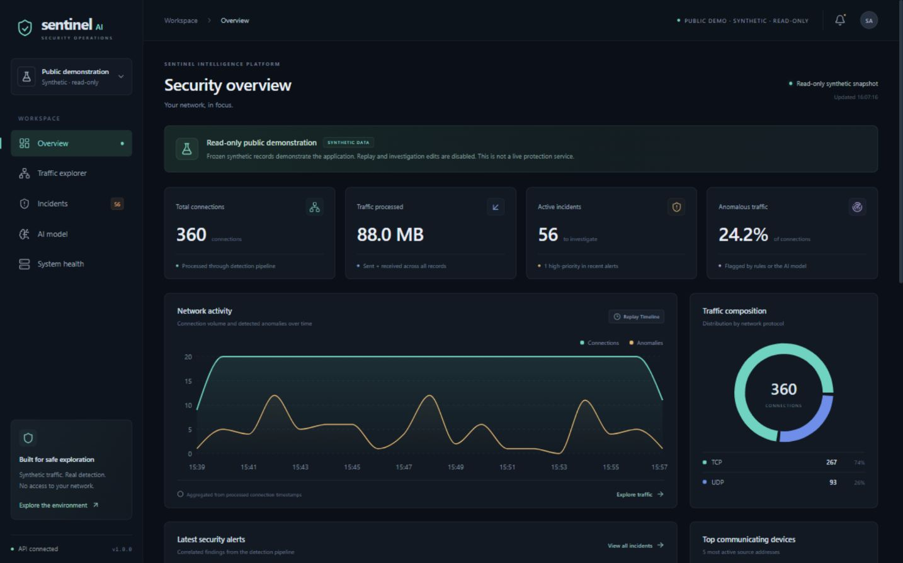
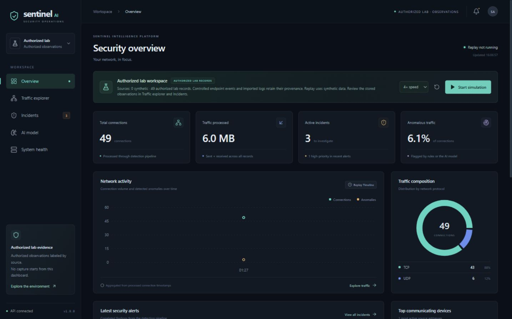

# Sentinel AI v1 release preparation — 7 November 2026

The existing application has been improved and verified as a local network-metadata analysis and investigation project. **The reviewed source is suitable for public repository preparation. Public hosting is prepared but has not been validated or deployed.** This is not a claim of production protection, comprehensive attack detection or whole-home visibility.

FastAPI, React, SQLite, the historical Isolation Forest, synthetic replay and real Windows collector were retained. No router/firewall/Windows security change, new physical capture, Git push or public deployment was performed.

## Implemented and verified

- Existing Demo Mode, 360-record replay, investigation storage and original model remain functional.
- A secure local launcher checks prerequisites by default; explicit actions select a wired adapter, start local services, view status/data, authorize one bounded collection or stop owned services.
- The dashboard separates synthetic records, controlled endpoint observations and Live Ethernet metadata. Historical live ML scores are informational, with evidence/context and saved priority preserved.
- Filtered tables wait for matching data before export; HTTP cancellation/timeouts, drawer loading/error handling, CSV safety/lineage and mobile keyboard navigation were improved.
- Private profile socket/Host/Origin checks, bounded loopback import transport, incompatible-database refusal and frontend environment-file handling were hardened.
- A separate public profile serves a frozen read-only **360-record synthetic snapshot**. It refuses private/incompatible databases and all API mutation requests. It cannot enable live/lab/PCAP ingestion.
- Requirements remain pinned; npm dependency versions/lockfile and original model files are unchanged. Frontend source and dependency licenses now ship with the built application.

## Genuine detection experiments

These events were generated using owned ephemeral **127.0.0.1** listeners. Client/server observations, timestamps, actual ephemeral ports and application byte counts were recorded in an exclusive `controlled_lab` database. The unchanged live rules processed those records. No packet capture, synthetic network fixture, external resolver, public scan or household-router request supplied this evidence.

| Scenario | Actual measured activity | Finding | Severity | Interpretation and limits |
|---|---|---|---|---|
| TCP probing pattern | Eight successful TCP exchanges across eight retained owned ports | `port_scan` | High | Authorized probing can trigger the same condition; this is not malicious-intent evidence |
| Connection burst | 25 distinct TCP exchanges to one owned peer/port in about six seconds | `connection_frequency` | Medium | Legitimate applications can also burst; no authentication outcome is inferred |
| Outbound volume | Three 2 KiB uploads and one **6 MiB** upload; both endpoints verified length and SHA-256 | `traffic_spike` | Medium | Aggregate outbound application bytes exceeded the existing 5,000,000-byte rule; legitimate upload, not proven exfiltration |
| Routine HTTPS | Three actual TLS-verified HTTPS requests with a disposable locally trusted certificate | None | — | No finding in this bounded sample; not general evidence that HTTPS is benign |
| Routine DNS | Three valid DNS-format UDP question/NXDOMAIN exchanges with an owned server | None | — | No public DNS query; no DNS tunneling or broad DNS-coverage evaluation |
| Discovery-like traffic | Three SSDP-format unicast request/reply exchanges | None | — | Tests a discovery-message scenario, not actual multicast discovery on a LAN |
| Router-like activity | Three small HTTP status exchanges with an owned router-role simulator | None | — | Does not test a real home router, its logs or visibility |

The final run produced **49 genuine endpoint observations, three rule incidents and three initial history entries**; all seven scenarios passed. Replaying unchanged evidence added zero observations/incidents. Services and disposable certificate material were cleaned up. A prior diagnostic run skipped HTTPS because one installed OpenSSL binary could not start in the sandbox; preferring the existing native Windows binary resolved that run-environment issue without installation or permission changes.

Application measurements exclude TLS/HTTP/network headers and retransmissions; this runner does not exercise Ethernet decoding or the keyed live ingestion transport. Ephemeral ports do not verify conventional service-port labels. No ML scores were fabricated for these lab observations. The preserved physical collector's decoder/schema/API compatibility is tested separately.

No expected finding was missed in these seven selected scenarios. Known broader misses remain: slow probing, activity split across collection windows, UDP/midstream or unknown-role TCP scans, low-volume malicious intent and authentication failures without application logs. Authorized scans, connection bursts and large uploads can produce nuisance findings. No thresholds were adjusted to manufacture outcomes.

## Real Ethernet status and preservation

The earlier normal Windows collection genuinely accepted **164 packets** and stored **18 Live Ethernet observations**. The owner had verified its dashboard and the November detection upgrade. This release also rendered those 18 rows and two historical baseline incidents in the actual browser using a **private database copy**. The scores were labeled informational, and the historical drawer identified its anchor and limitations. No new physical capture was run.

Final stable-copy checks of the original main databases/WAL files passed integrity and complete table-content fingerprint comparisons:

| Original state | Preserved |
|---|---|
| Monitoring connections / incidents / history | **18 / 2 / 3**, including the existing note |
| Demo connections / incidents / history | **360 / 56 / 57** |
| Metadata and monitor ingestion-batch tables | All original rows unchanged |
| Model, preprocessing/inference/training, rule engines, pins/lockfile, MIT and five October screenshots | Original hashes unchanged |

Notes/status/replay verification used disposable copies. The genuine controlled-run database was also preserved; browser investigation edits used another copy. Private records, copies, audit evidence, capture files and local identifiers are excluded from publication.

## Exact local Windows use

Run from the existing project root in a **normal PowerShell**:

```powershell
# Read-only default: no adapter access, services, capture or key prompt.
.\.venv\Scripts\python.exe scripts/local_monitor.py --check

# Open the explicit menu; opening it does not start collection.
.\sentinel-monitor.cmd
```

Choose **3** to start/reuse the local backend on `127.0.0.1:8004` and frontend on `127.0.0.1:5176`, then **5** to open the dashboard. View Traffic Explorer to inspect saved observations without capture. The normal launcher-owned backend uses `data/monitoring/windows-monitor.db`; do not substitute an empty database for original evidence.

To authorize a *new* observation, choose **2**, select the actual physical wired adapter by its displayed label/model and confirm `WIRED` only if automatic physical verification is unavailable. Then choose **6**, review the preview and type **START**. The existing collector runs for at most **15 seconds / 5,000 packets / 1,000 flow aggregates**. Addresses are refreshed before collection. Enter cancels; Ctrl+C interrupts collection and requests cleanup. There is no continuous loop or dashboard capture endpoint.

Choose **4** for status. Receipt recency is not a running-sensor heartbeat. Choose **7** or **0** to stop services created by this launcher; external/reused services stay running. The original manual backend/frontend can be stopped with Ctrl+C in their respective terminals. Database evidence is retained.

New owned-service keys exist only in memory/child environment. When explicitly collecting through a reused external monitor, the launcher privately prompts for its **existing** key, without echo or persistence. It never prints or bundles that key. A stale backend is refused and left alone; restart it in its existing terminal with its original key/environment/database, then reuse it. See [the full Windows guide](windows-monitoring.md) for manual commands, prerequisites and failure recovery.

The actual launcher check found installed dependencies and wired-type candidates without opening an adapter. Optional physical verification was unavailable in this process context, so this check alone cannot certify the chosen adapter or Npcap permissions. The actual owned-service smoke started both fixed local services, proxied 18 observations from a disposable database copy and stopped both processes/ports. It did not invoke the collector. A new launcher-driven physical capture remains an explicit owner action.

## Automated, HTTP and browser evidence

| Check | Executed result |
|---|---|
| Python suite in existing Windows project | **328 passed**, 26.80 seconds; one upstream Starlette/HTTPX deprecation warning |
| Frontend tests | **18 passed** |
| TypeScript and standard production build | Passed; existing >500 kB JS-chunk advisory remains |
| Dependency consistency / notices / owned license | Passed |
| Actual four-profile HTTP | Public isolation/write refusal; lab lineage; old-live read compatibility; search/protocol/pagination; copy note/status/history; Demo replay/pause/reset passed |
| Actual desktop browser | All five public views, UDP+DNS filtering (**74 matches**), high/rule incident filtering (**12 matches**), read-only investigation and CSV download verified |
| Actual downloaded CSV | **50 current-page rows**, all synthetic UDP; header includes origin and available lineage/score qualification |
| Actual lab investigation browser | Verified 6 MiB evidence, note save, status change and history on a disposable controlled-lab copy |
| Actual private-monitor browser | **18 live rows / two historical findings**, qualified baseline explanation; no private screenshot/export |
| Responsive/keyboard sample | Desktop **1440 × 900** and mobile **390 × 844**; model layout, mobile navigation focus wrapping/Escape/focus return/body-overflow cleanup passed |
| Compose schema | Both local configuration files validate; runtime not executed |

The initial browser approval/provider/native URL-policy problems were investigated. A later supported in-app browser enabled the successful checks and genuine images. No policy bypass was used. Owned QA services and browser tab were stopped/closed and the temporary viewport reset.

Remaining verification includes a full screen-reader/contrast/multi-browser/breakpoint matrix, all GUI error/retry states, GUI replay-control interaction, Linux/macOS/Python 3.12 runtime, a fresh-machine installation, remote GitHub Actions, container startup/nginx and container-image advisories. The current Docker engine was unavailable. These limits are distinct from reproducible application failures; see [known issues](known-issues.md).

## ML assessment

The unchanged Isolation Forest is a historical KDD Cup 1999 research baseline, with its original held-out metrics and dataset attribution. Demo/imported-lab behavior is retained. New Live Ethernet scores are informational and create no new ML incidents; rule conditions supply new live findings. Historical findings retain their notes, status and saved priority.

Eighteen unlabeled observations and a few purpose-built localhost scenarios cannot justify a new live model or scientifically valid private-network precision/recall/F1. No retraining or accuracy claim was introduced. A dedicated live model would require representative consented benign activity, independently labeled attacks, comparable feature semantics, separate temporal/host/network validation, measured false positives and drift monitoring.

## Security and publication decision

Private monitor/lab APIs enforce loopback peers, literal loopback Hosts and trusted browser origins for writes. Ingestion/status require the configured private key. **Private reads and incident edits trust local processes/users rather than a multi-user login.** Keep them local; CORS does not make a public private-data API safe. The public profile is separate and read-only.

The collector requests a bounded 128-byte RAM pipe from dumpcap to TShark and exports allowlisted metadata; no raw packet filename is requested. Prefixes can contain application fragments in RAM. Byte counters are header-derived transport payload lengths, not decrypted content or verified wire totals. No process attribution, password-failure evidence or guaranteed packet completeness is available. Capacity limits stop new ingestion instead of deleting old evidence; no automatic age-based deletion or disk encryption is supplied.

The original `.gitignore` already excludes venvs, node_modules, caches/builds, environment secrets, authentication material, databases/WAL sidecars, captures, traffic exports and runtime data; it was retained and rechecked. Only reviewed synthetic fixtures and three original model files are allowlisted. Docker contexts also exclude private runtime state. The final manifest and source archive deliberately omit all actual private databases/telemetry/configuration.

Old install-tool advisories were resolved by upgrading only venv **pip to 26.3** and **setuptools to 84.2.1**. Application pins and model dependencies were retained. A refreshed OSV query returned **zero affected pairs among 204 installed-Python/npm name-version pairs** at this date. This lookup excludes OS, browser, container, Npcap and Wireshark vulnerabilities and is not an absence-of-vulnerabilities guarantee.

The existing owned-source **MIT** license is retained. The frontend ships its license and reviewed production third-party license/copyright notices. Dataset attribution and CC BY 4.0 remain separate. See [SECURITY](../SECURITY.md), [publication audit](publication-audit.md) and [the exact file manifest](publication-files.txt).

**Source publication:** the reviewed manifest/archive is suitable for a professional public repository with these honest limitations. Review the exact future staged diff and Git history before committing; `.gitignore` does not sanitize arbitrary files or already tracked secrets. No Git initialization/commit/push or portfolio publication was performed.

**Public demo:** a frozen synthetic-only profile and isolated Compose volume are implemented and locally HTTP/browser verified. Public deployment is still unverified. The current SQLite/process architecture fits a single-worker FastAPI container with writable storage and a same-origin static frontend/proxy. Other hosts, including native FastAPI on Vercel, require validated filesystem/lifecycle/dependency choices rather than assuming compatibility. Complete container/hosting tests and obtain explicit deployment authorization first. See [deployment](deployment.md). Never expose live capture or mount a home-network database.

## Whole-home monitoring

The current collector observes traffic visible on the selected laptop interface. Ethernet switching does not normally deliver other devices' unicast traffic to that laptop. The previously inspected router showed connected devices/basic current rates; detailed traffic export/security-event logging was not verified. No router change was made.

Whole-home monitoring would require separately authorized gateway capture or supported flow/log export, a managed switch mirror/SPAN or network TAP with a suitable sensor, and a design for consent, VLAN/Wi-Fi coverage, storage/retention, clock synchronization, encrypted-traffic limits, representative evaluation and authenticated private access. Hardware/provider support must be checked before buying or changing equipment. A dashboard setting cannot supply missing network visibility.

## Genuine screenshots

The images below are actual rendered application captures from 7 November 2026. They contain only synthetic demonstration data or disposable owned-loopback activity. Older October images remain unchanged and separately dated.





Additional screenshots: [filtered traffic](screenshots/v1-public-traffic.jpg), [read-only investigation](screenshots/v1-public-investigation.jpg), [lab investigation history](screenshots/v1-controlled-lab.jpg), [mobile model](screenshots/v1-mobile-model.jpg).
